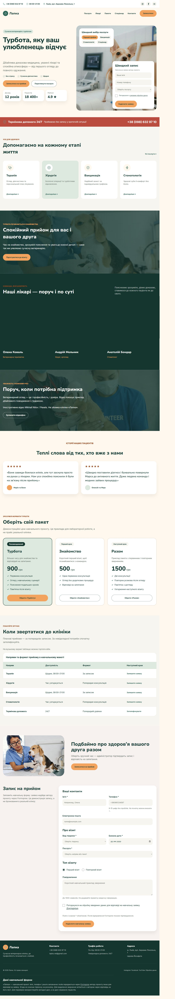

# Ветеринарна клініка «Лапка»

Навчальний односторінковий сайт за макетом Figma, розроблений у межах модулів 02–08 курсу вебтехнологій.

- **Сайт:** https://MaksSt33.github.io/vetclinic/
- **Макет:** [Vetclinic у Figma](https://www.figma.com/design/QMHLRv3P49GmNWXlGBgmnc/Vetclinic?node-id=9-561)
- **Методичка:** [Академія 9 DOTS — веброзробка](https://9.lviv.ua/academy/web-development/)
- **Виконання вимог:** [чек-лист і результати перевірок](docs/checklist.md)
- **Розбір коду:** [пояснення для захисту лабораторних](docs/lab-guide.md)

## Що реалізовано

| Модуль | Результат |
| --- | --- |
| 02 — HTML, CSS, Flexbox | Семантична сторінка, локальні шрифти, власні стилі, ряди й колонки на Flexbox |
| 03 — адаптивність і меню | Точки 1200/900/600 px, мобільна версія, випадаюче меню ПК, CSS-бургер із клавіатурним керуванням |
| 04 — мультимедіа | Оптимізовані WebP і WOFF2, фонове фото, MP4-відео з постером та керуванням видимістю руху |
| 05 — форми та таблиці | Справжня відправка через Formspree, валідація, fieldset/legend/label, таблиця в прокручуваній обгортці |
| 06 — UI-компоненти | Три демонстраційні пакети, рекомендований пакет перший, однакова висота карток і вирівняні кнопки |
| 07 — анімації | Плавні стани, transform і власна keyframes-анімація, підтримка reduced-motion |
| 08 — Git і GitHub Pages | Історія змістовних комітів, .gitignore, публічний репозиторій і сайт |

Сайт використовує **HTML5 та CSS**, без JavaScript, фреймворків, Grid і табличної розкладки. Таблиця містить дані й не використовується для розміщення блоків.

## Перегляд

Відкрийте живий сайт за посиланням вище або `index.html` із папки проєкту. Для локальної розробки можна використовувати Live Server або запустити з папки проєкту:

```sh
python -m http.server 8001 --bind 127.0.0.1
```

Після цього відкрийте http://127.0.0.1:8001/. Встановлювати залежності для самого сайту не потрібно. Для відправлення форми потрібен інтернет.

## Структура

```text
index.html          # єдина сторінка
css/
  style.css         # компоненти, адаптивність, анімації
  fonts.css         # локальні @font-face
fonts/              # WOFF2 та ліцензії шрифтів
img/                # WebP, SVG, невеликі PNG-іконки
video/
  vet-care.mp4      # 12 секунд, 1280 × 720, без звуку
docs/               # перевірки, пояснення та знімки екрана
.gitignore
.gitattributes
.nojekyll
```

## Форми

Обидві контактні форми надсилаються методом POST на налаштований власником endpoint Formspree. Є обов’язкові поля, перевірка email і телефону, згода та приховане поле-пастка для простих спамботів. Тестова заявка від 16.10.2026 успішно відправлена; власник підтвердив отримання листа.

Це **навчальний проєкт**. Заявка надходить автору проєкту, а не реальній клініці. Для тестування використовуйте вигадані дані. Ціни пакетів також демонстраційні. Соціальні посилання ведуть на головні сторінки сервісів, оскільки справжні профілі клініки не надані.

## Макет і доступність

Основою залишаються кольори, шрифти та композиція Figma. Контраст дрібного помаранчевого тексту, сірого тексту й стану кнопок підвищено для читабельності. Розміри 20/22/28 px із макета збережені там, де вони потрібні: шкала відступів у методичці наведена як приклад.

На смартфоні збережені зміст і доступні дії. Повторні контактні дані перенесені в підвал, а дубль швидкої форми й панель поверх фото приховані: головна форма та навігація залишаються доступними. Унікальна статистика й переваги розміщуються після фото. Нові секції доповнюють початковий макет відповідно до наступних модулів.

Меню використовує CSS `:target` і звичайні HTML-кнопки в порожніх GET-формах. Воно працює з Enter і Пробілом; перехід за посиланням змінює якір і закриває меню. У URL може з’являтися порожній знак `?`; перше відкриття може повторно завантажити документ. Це компроміс реалізації без JavaScript, який забезпечує поведінку з чек-листа замість неповного закриття checkbox-меню з прикладу.

## Медіа та джерела

- Фотографії, знак у шапці й іконки послуг експортовані з наданого макета Figma. Тексти, імена й зображення використані як елементи навчального дизайну.
- Відео: **Mikhail Nilov**, [Examining a Dog, Pexels](https://www.pexels.com/video/examining-a-dog-7469712/), [ліцензія Pexels](https://www.pexels.com/license/). Використано 12-секундний фрагмент, без звуку, зі стисненням і зміною розміру. Це ілюстративне відео, не зйомка клініки «Лапка».
- Inter і Nunito Sans — Google Fonts, ліцензії OFL збережені в `fonts/`.
- Постер узятий із першого кадру локального відео. У режимі зменшеного руху показується нерухомий фон.




