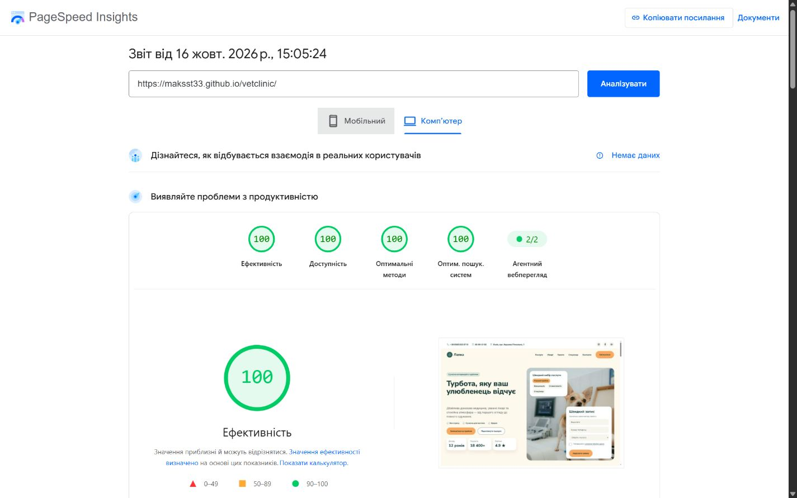
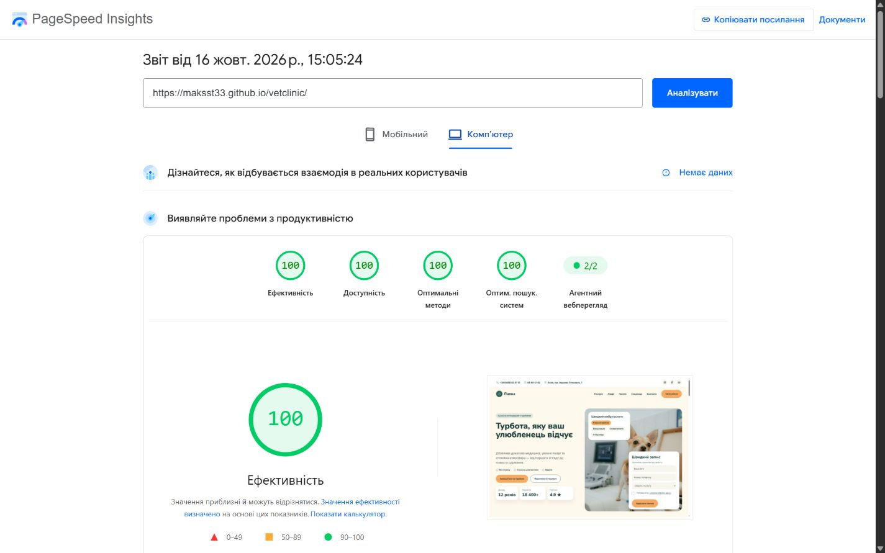

# Перевірка лабораторних 02–08

Дата: 16.10.2026. Методичка: https://9.lviv.ua/academy/web-development/.

| Модуль | Реалізація та перевірка |
| --- | --- |
| 02 | Семантичні header/main/section/article/nav/footer, Flexbox. Nu HTML Checker 26.10.12: 0 помилок і 0 попереджень. |
| 03 | Точки 1200/900/600 px; перевірені 320, 360, 375, 390, 415, 600, 601, 768, 900, 901, 1024, 1200, 1440, 1920 px без горизонтального переповнення. Меню відкривається й закривається клавіатурою та після вибору якоря. |
| 04 | Фонові фото й відео з накладанням; WebP, WOFF2, lazy-loading, alt і розміри. Усі фото разом 222454 байти, MP4 H.264 1142459 байтів, 12 с, 1280×720, без звуку. Постер із цього відео. |
| 05 | Formspree POST, підписи, групування полів, 6 типів input, валідація телефону/email, згода, honeypot. Тест відправлено, власник підтвердив отримання листа. Таблиця прокручується у власній обгортці при 320 px. |
| 06 | Три демонстраційні пакети; рекомендований перший у DOM і на телефоні. При 1920 px усі картки однакової висоти 547.37 px, кнопки вирівняні внизу. Стани hover/focus/active/disabled. |
| 07 | Явні transition, transform і keyframes. Останній CSS-блок вимикає рух при prefers-reduced-motion. |
| 08 | main, змістовні коміти, .gitignore, README. Публічний репозиторій MaksSt33/vetclinic; git push виконано. GitHub Pages: main / (root), HTTPS, сайт відкривається. |

## Перевірка опублікованого сайту

- Сайт: https://maksst33.github.io/vetclinic/
- Код: https://github.com/MaksSt33/vetclinic
- Усі 30 перевірених ресурсів повернули HTTP 200; немає повторних id та битих внутрішніх якорів.
- У Chrome відео автоматично відтворюється без звуку (readyState 4, paused false, currentTime змінюється). Плеєр не повідомляє помилок.
- У консолі немає помилок сайту. Попередження від стороннього браузерного розширення не належать коду сторінки.
- Власник перевірив живий сайт на справжньому телефоні й 16.10.2026 відповів: «так поки норм». Модель і браузер не зазначені.
- Режим зменшеного руху перевірений за HTML/CSS: умовне джерело video та фінальний media-запит. Окреме перемикання системного налаштування на пристрої не перевірялося.

### PageSpeed Insights

[Звіт 16.10.2026, 15:05](https://pagespeed.web.dev/analysis/https-maksst33-github-io-vetclinic/x3aveu9krj?form_factor=mobile).

| Категорія | Мобільний | ПК |
| --- | ---: | ---: |
| Ефективність | 84 | 100 |
| Доступність | 100 | 100 |
| Найкращі практики | 100 | 100 |
| SEO | 100 | 100 |

Перший аудит виявив низький контраст трьох типів тексту; кольори виправлено й повторний аудит пройдено. Додано preload двох основних шрифтів. Оцінки є результатом одного лабораторного вимірювання й можуть змінюватися. Для нового сайту немає польових даних реальних відвідувань. Основні залишкові рекомендації стосуються блокувальних CSS і терміну кешування GitHub Pages; серверні HTTP-заголовки Pages не налаштовуються файлами цього проєкту.

## Відмінності та обмеження

Нові секції додані за вимогами модулів 04–06 і не були частиною початкового Figma. Дрібний текст і стани кнопок мають посилений контраст. Числові відступи перевіряються способом із [пояснення до лабораторних](lab-guide.md#як-порівняти-з-figma); не заявляється автоматична попіксельна тотожність усієї розширеної сторінки.

CSS-меню використовує :target і нативні GET-кнопки: перше відкриття може перезавантажити сторінку й додати порожній ?. Відеоперемикач приховує відео, залишаючи постер; це не програмний pause(). Соціальні посилання ведуть на головні сторінки сервісів. Проєкт і ціни навчальні.
